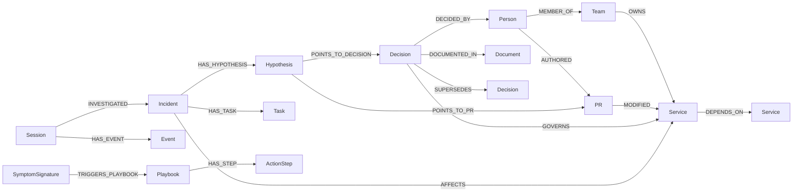

# AegisGraph

> V2 upgrade: model-directed MCP investigation, derived graph telemetry, versioned
> playbook gates, step-level crash/resume and measured comparison panel are implemented.
> See [V2_WORKFLOW.md](docs/V2_WORKFLOW.md) for setup, formulas, metrics and verification limits.
> Live Gemini validation passed for all three modes; see [measured results](docs/V2_LIVE_RESULTS.md). Supply your own key locally when running a copy.
> Earlier sections below describe the preserved V1 endpoints; the main UI now uses /api/runs.


Bi-temporal company brain, graph-native coordination and executable procedural memory on FalkorDB.

**Tracks:** Track 01 — Agents That Act on Connected Data; Track 02 — Agent Memory and Coordination; Track 03 — Company Brain.

## Run locally
Install Docker Desktop with its Linux engine running. From this directory:
```sh
docker compose up --build
```
Open the [command center](http://localhost:3001), [API docs](http://localhost:8000/docs), or [FalkorDB Browser](http://localhost:3000).
Browser login: host localhost, port 6379, empty username/password, TLS off.
The frontend uses port 3001 because FalkorDB Browser uses 3000.
Docker Compose seeds both synthetic tenants once; repeated starts preserve state.
No API key is required. No secondary database or offline data fallback exists.

### Reset and stop
```sh
docker compose run --rm seed python -m backend.seed_graph --reset
docker compose stop
```
Reset deletes and reseeds both synthetic production tenant graphs, including incidents and playbooks.
Stop preserves the Docker volume. Do not delete the volume if you want to keep the demo history.

### Development without application containers
Run FalkorDB with `docker compose up -d falkordb`. With Python 3.11+ and Node 22+:
```sh
python -m venv .venv
# Activate .venv using your platform's activation command.
pip install -r backend/requirements.txt
python -m backend.seed_graph
python -m uvicorn backend.main:app --host 127.0.0.1 --port 8000
# In a second terminal:
cd frontend
npm ci
npm run dev
```
For Cloud, configure the environment variables listed in .env.example.
Uvicorn can load a local environment file with `--env-file .env`.
The frontend's public API URL is a build-time value. Never put database credentials in frontend environment variables.

## The VortexPay demo
All names, policies, PRs, and operational measurements are synthetic.
1. Inject policy contradiction: Scribe records Sarah Chen's Slack decision DEC-02, superseding DOC-101's 5000ms timeout.
2. Investigate checkout incident: Navigator follows dependencies to Elena Rostova's PR-409, ranks bottlenecks, and checks the configuration fix in a shadow graph.
3. Commander applies a synthetic 150ms timeout, bounded pool and circuit breaker, checks the returned postcondition, and compiles the action into a playbook.
4. New session / replay: Commander retrieves the stored tool and arguments from FalkorDB and executes them. Old session evidence remains stored.
5. Simulate service isolation: the shadow graph loses connectivity from web-storefront, checkout-api, and payment-orchestrator; the production topology is preserved.
Click an activity to inspect its exact query, database timing and highlighted nodes.
The composer adds a note to the fixed checkout incident workflow; it is not a general-purpose assistant.

## Architecture and graph model
FastAPI and the MCP server share six parameterized tools. Specialist agents use a deterministic, synchronous orchestration loop.
They do not currently use LLM reasoning, independent autonomous workers, or asynchronous scheduling.
Agent state is durable in FalkorDB; Python variables only hold the current call's transient results.
Session reset creates a new Session rather than deleting procedural memory.
The only durable state store is FalkorDB, including Events, Tasks, Hypotheses and playbooks.



The fixture contains 3 teams, 6 people and 8 services, including notification-worker to complete the eight-node topology.
The shortest service path checkout-api → token-auth-service is one hop; web-storefront reaches auth in two.
Bi-temporal Decision versions contain effective intervals (valid_from/valid_to) and knowledge intervals (recorded_from/recorded_to).
Zero interval end means open-ended. Supersession closes the previous effective interval and preserves a historical recorded version.
resolve_bitemporal_policy accepts valid_at and known_at for time-travel queries.
A graph Runtime node contains the active session and a five-minute mutation lease.
Graph names are allowlisted; tenant_beta is also used as a disposable integration-test fixture.

## Six graph tools
Each returns data, cypher_executed, execution_time_ms from FalkorDB metadata, highlighted_node_ids, and graph.
Shadow simulations additionally return the native GRAPH.COPY command and individual query traces.
The timing sum excludes clone wall time and network/agent overhead.
The supported 'rollback' action repairs configuration while retaining the current 150ms policy; it does not revert PR-409 or execute an external infrastructure command.
The simulator compares reachability before and after a mutation; topology safety is not proof of real service performance.

### trace_root_cause_and_blast_radius(service_name: str)

```cypher
MATCH (failing:Service {name: $service_name})
MATCH (upstream:Service)<-[:MODIFIED]-(pr:PR)<-[:AUTHORED]-(dev:Person)
WITH failing, upstream, pr, dev,
 shortestPath((failing)-[:DEPENDS_ON*0..5]->(upstream)) AS p
WHERE p IS NOT NULL
OPTIONAL MATCH (downstream:Service)-[:DEPENDS_ON*1..4]->(failing)
OPTIONAL MATCH (team:Team)-[:OWNS]->(upstream)
RETURN [n IN nodes(p) | n.name] AS dependency_path,
 upstream.name AS root_service, pr.id AS suspect_pr, pr.title AS pr_title,
 dev.name AS author_name, dev.handle AS author_handle, team.name AS owning_team,
 collect(DISTINCT downstream.name) AS downstream_blast_radius,
 [n IN nodes(p) | n.id] + [pr.id, dev.id, team.id] AS highlighted_node_ids,
 length(p) AS path_hops, pr.timestamp AS pr_timestamp
ORDER BY path_hops ASC, pr_timestamp DESC LIMIT 3
```

### compute_service_criticality_pagerank()

```cypher
CALL algo.pageRank('Service', 'DEPENDS_ON') YIELD node, score
RETURN node.name AS service_name, node.tier AS tier, node.status AS status,
 score AS pagerank_score, [node.id] AS highlighted_node_ids
ORDER BY pagerank_score DESC LIMIT 10
```

### resolve_bitemporal_policy(service_name: str)

```cypher
MATCH (s:Service {name:$service_name})<-[:GOVERNS]-(active:Decision)
WHERE active.valid_from <= $valid_at AND (active.valid_to=0 OR $valid_at < active.valid_to)
 AND active.recorded_from <= $known_at AND (active.recorded_to=0 OR $known_at < active.recorded_to)
OPTIONAL MATCH (active)-[:DECIDED_BY]->(author:Person)
OPTIONAL MATCH path=(active)-[:SUPERSEDES*1..5]->(old:Decision)
RETURN active.id AS active_decision_id, active.summary AS current_policy,
 active.source AS current_source, active.valid_from AS valid_from,
 author.name AS decided_by,
 CASE WHEN path IS NULL THEN [] ELSE
 [d IN nodes(path) WHERE d <> active |
 {id:d.id, summary:d.summary, source:d.source, valid_to:d.valid_to}] END AS superseded_history,
 [s.id,active.id,author.id] + CASE WHEN path IS NULL THEN [] ELSE [d IN nodes(path)|d.id] END
 AS highlighted_node_ids
```

### ingest_and_supersede_decision(...)

```cypher
MATCH (s:Service {name:$service_name})<-[:GOVERNS]-(old:Decision {topic:$topic, status:'ACTIVE'})
MATCH (p:Person {name:$person_name})
WHERE old.valid_from < $timestamp
SET old.status='SUPERSEDED', old.valid_to=$timestamp, old.recorded_to=$recorded_at
CREATE (historical:Decision {id:old.id+'@'+toString($recorded_at), topic:old.topic,
 summary:old.summary, source:old.source, valid_from:old.valid_from, valid_to:0,
 recorded_from:old.recorded_from, recorded_to:$recorded_at, status:'HISTORICAL'})
CREATE (historical)-[:GOVERNS]->(s)
SET old.recorded_from=$recorded_at, old.recorded_to=0
CREATE (new:Decision {id:$new_id, topic:$topic, summary:$new_summary, source:$source,
 valid_from:$timestamp, valid_to:0, recorded_from:$recorded_at, recorded_to:0, status:'ACTIVE'})
CREATE (new)-[:GOVERNS]->(s), (new)-[:DECIDED_BY]->(p),
 (new)-[:SUPERSEDES {reason:$reason, timestamp:$timestamp}]->(old)
RETURN new.id AS created_decision, old.id AS superseded_decision,
 [s.id, p.id, old.id, new.id] AS highlighted_node_ids
```

### lookup_procedural_playbook(error_code: str, service_name: str)

```cypher
MATCH (sig:SymptomSignature {error_code:$error_code, affected_service:$service_name})
 -[:TRIGGERS_PLAYBOOK]->(pb:Playbook)
MATCH (pb)-[:HAS_STEP]->(step:ActionStep)
RETURN pb.id AS playbook_id, pb.name AS playbook_name, pb.success_count AS prior_successes,
 step.step_order AS step_order, step.mcp_tool AS tool_name,
 step.tool_args_json AS tool_args, step.expected_outcome AS outcome,
 [sig.id,pb.id,step.id] AS highlighted_node_ids
ORDER BY step.step_order ASC
```

### simulate_action_in_shadow_graph(target_service: str, action: str)

```cypher
MATCH (target:Service {name:$target_service})
OPTIONAL MATCH (caller:Service)-[:DEPENDS_ON*1..4]->(target)
WHERE caller.tier=1
RETURN count(DISTINCT caller) AS impacted_tier1_services,
 collect(DISTINCT caller.name) AS impacted_names,
 collect(DISTINCT caller.id)+[target.id] AS highlighted_node_ids
```

The executable query bodies above include corrections required by the installed FalkorDB version.
The exact original six specification blocks are retained in [MASTER_SPEC.md](MASTER_SPEC.md), section 5.
The simulator also runs the following reachability query before and after the shadow mutation:
```cypher
MATCH (caller:Service {tier:1}), (dest:Service {name:$target_service})
MATCH p=(caller)-[:DEPENDS_ON*1..5]->(dest)
RETURN collect(DISTINCT caller.name) AS reachable,
 collect(DISTINCT caller.id) AS highlighted_node_ids
```

## Verification
```sh
python -m pytest backend/tests -q
cd frontend
npm run typecheck
npm run build
```
Tests require reachable FalkorDB and reset **tenant_beta**; do not keep valuable state there.
[CHECKPOINTS.md](CHECKPOINTS.md) records staged validation and limits.
The unplug check stops the FalkorDB container and confirms all seven stateful API endpoints return 503.
The static frontend shell and API schema remain available; operations cannot function without FalkorDB.

## MCP
```sh
python -m backend.mcp_server
```
This exposes the six tools over stdio. Use the repository root as the working directory and configure database environment variables on the MCP process.
Stored procedural tool calls pass a strict name/arguments allowlist; arbitrary shell execution is not supported.

## Deployment and submission
This repository supports complete local setup, an accepted alternative to live deployment under Rule 10.
No public deployment URL, public repository URL, or submission video has been produced yet.
The UI uses custom CSS, Lucide icons, Framer Motion and react-force-graph-2d. Unused Tailwind tooling was removed to eliminate vulnerable transitive dependencies.

### Browser check
After starting the app, install frontend development dependencies with npm ci.
The check expects a fresh synthetic beta fixture:
```sh
python -m backend.seed_graph --tenant tenant_beta --reset
node scripts/check-ui.cjs --live
```
On Windows it uses installed Microsoft Edge; on Linux install Chromium via `cd frontend && npx playwright install --with-deps chromium`.
The browser check writes screenshots and a silent demo.webm recording to docs/ and exercises the full demo flow. On Windows, install the encoder once with `cd frontend && npx playwright install ffmpeg`.

For live hosting, deploy the Python backend on a service supporting outbound TCP to FalkorDB Cloud, and the frontend on a Next.js host.
Set FALKORDB_HOST, PORT, USERNAME, PASSWORD, SSL on the backend and CORS_ORIGINS to the real frontend origin.
Set NEXT_PUBLIC_API_URL to the HTTPS backend origin before building the frontend.
The current API has no user authentication; keep the local demo private, and add authentication before opening write endpoints to the internet.
Do not expose the local unauthenticated Redis port publicly.

Before submission, add the public repository URL, video URL, author/team identity and either deployment URL or this complete local setup.
Review [docs/DEMO.md](docs/DEMO.md) and explain the implementation yourself.
Official event: https://www.wemakedevs.org/hackathons/falkordb
Official rules: https://www.wemakedevs.org/hackathons/falkordb/rules

## AI assistance disclosure
Codex was used for implementation, component scaffolding, integration tests and debugging.
The project architecture was supplied by the participant in MASTER_SPEC.md.
Participant code review, independent verification and author/team attribution remain to be completed before submission.
Do not claim participant verification until you have run and understood the demo yourself.

## Original specification queries (verbatim)

These are retained for comparison; use the corrected executable queries above.

## 5. Core Cypher Queries & FalkorDB Algorithms (Rule 10 Deliverable)

Your backend *must* expose these 6 deterministic Cypher/Algorithm functions inside backend/mcp_tools.py and list them verbatim in your README.md.

### Tool 1: trace_root_cause_and_blast_radius(service_name: str)

Uses shortestPath to connect a failing service to recent upstream PRs and computes downstream impact + subject matter expert ownership:

cypher
MATCH (failing:Service {name: $service_name})
MATCH (upstream:Service)<-[:MODIFIED]-(pr:PR)<-[:AUTHORED]-(dev:Person)
MATCH p = shortestPath((failing)-[:DEPENDS_ON*0..5]->(upstream))
OPTIONAL MATCH (downstream:Service)-[:DEPENDS_ON*1..4]->(failing)
OPTIONAL MATCH (team:Team)-[:OWNS]->(upstream)
RETURN 
  [n IN nodes(p) | n.name] AS dependency_path,
  upstream.name AS root_service,
  pr.id AS suspect_pr,
  pr.title AS pr_title,
  dev.name AS author_name,
  dev.handle AS author_handle,
  team.name AS owning_team,
  collect(DISTINCT downstream.name) AS downstream_blast_radius
ORDER BY length(p) ASC, pr.timestamp DESC
LIMIT 3


### Tool 2: compute_service_criticality_pagerank()

Uses FalkorDB’s native algo.pageRank procedure to identify architectural bottlenecks:

cypher
CALL algo.pageRank('Service', 'DEPENDS_ON') YIELD node, score
RETURN node.name AS service_name, node.tier AS tier, node.status AS status, score AS pagerank_score
ORDER BY pagerank_score DESC
LIMIT 10


### Tool 3: resolve_bitemporal_policy(service_name: str)

Detects active vs. superseded company decisions and returns the full contradiction lineage:

cypher
MATCH (s:Service {name: $service_name})<-[:GOVERNS]-(active:Decision {status: 'ACTIVE'})
OPTIONAL MATCH (active)-[:DECIDED_BY]->(author:Person)
OPTIONAL MATCH path = (active)-[:SUPERSEDES*1..5]->(old:Decision)
RETURN 
  active.id AS active_decision_id,
  active.summary AS current_policy,
  active.source AS current_source,
  active.valid_from AS valid_from,
  author.name AS decided_by,
  [d IN nodes(path) WHERE d <> active | {id: d.id, summary: d.summary, source: d.source, valid_to: d.valid_to}] AS superseded_history


### Tool 4: ingest_and_supersede_decision(...)

Used by the *Scribe Agent* when a new Slack message or PR overrides an older policy:

cypher
MATCH (s:Service {name: $service_name})<-[:GOVERNS]-(old:Decision {topic: $topic, status: 'ACTIVE'})
MATCH (p:Person {name: $person_name})
SET old.status = 'SUPERSEDED', old.valid_to = $timestamp
CREATE (new:Decision {
  id: $new_id,
  topic: $topic,
  summary: $new_summary,
  source: $source,
  valid_from: $timestamp,
  valid_to: 0,
  status: 'ACTIVE'
})
CREATE (new)-[:GOVERNS]->(s)
CREATE (new)-[:DECIDED_BY]->(p)
CREATE (new)-[:SUPERSEDES {reason: $reason, timestamp: $timestamp}]->(old)
RETURN new.id AS created_decision, old.id AS superseded_decision


### Tool 5: lookup_procedural_playbook(error_code: str, service_name: str)

Used by the *Commander Agent* at the start of any session to check if the graph already knows how to solve this exact problem:

cypher
MATCH (sig:SymptomSignature {error_code: $error_code, affected_service: $service_name})-[:TRIGGERS_PLAYBOOK]->(pb:Playbook)
MATCH (pb)-[r:HAS_STEP]->(step:ActionStep)
RETURN 
  pb.id AS playbook_id,
  pb.name AS playbook_name,
  pb.success_count AS prior_successes,
  step.step_order AS step_order,
  step.mcp_tool AS tool_name,
  step.tool_args_json AS tool_args,
  step.expected_outcome AS outcome
ORDER BY step.step_order ASC


### Tool 6: simulate_action_in_shadow_graph(target_service: str, action: str)

Demonstrates FalkorDB’s multi-graph capability by cloning the dependency topology into vortexpay_sandbox, isolating the node, and checking which Tier-1 services lose connectivity:

cypher
// Executed on graph: vortexpay_sandbox
MATCH (target:Service {name: $target_service})
MATCH (caller:Service)-[:DEPENDS_ON*1..4]->(target)
WHERE caller.tier = 1
RETURN count(DISTINCT caller) AS impacted_tier1_services, collect(DISTINCT caller.name) AS impacted_names


---

