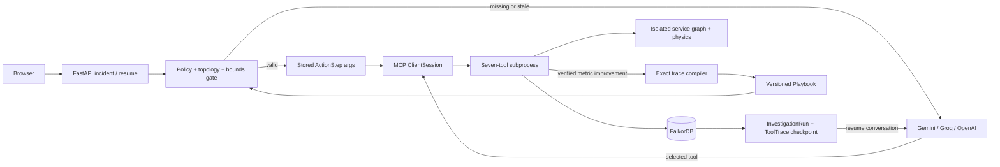

# AegisGraph V2 implementation and verification

The approved MASTER_SPEC_V2.md is retained unchanged in the repository root.

## Model access on a free tier
The default adapter uses Gemini's OpenAI-compatible endpoint and a configurable model.
Groq and OpenAI endpoints are supported by the same tool-calling adapter.
A free tier is subject to the selected model's availability and your account's quotas.
Only configured provider routes are used; billing settings are never changed. Gemini-first selection can fail over to an explicitly configured Groq key.
Check these official pages for your account:
- https://ai.google.dev/gemini-api/docs/pricing
- https://ai.google.dev/gemini-api/docs/openai
- https://console.groq.com/docs/rate-limits
- https://console.groq.com/docs/tool-use/overview

Copy .env.example to .env only if .env does not already exist.
For Gemini, set GEMINI_API_KEY locally. LLM_PROVIDER=gemini.
For Groq, set GROQ_API_KEY locally, LLM_PROVIDER=groq and a supported LLM_MODEL.
Then run docker compose up --build -d to recreate backend with the new environment.
The public evidence endpoint returns only configured=true/false, never a key.
Missing key returns a configuration error before a V2 incident is created.
Provider failures exhaust bounded retries and configured routes before retaining the checkpoint for resume.
The UI composer now sends the actual incident description to the model.

## Execution path
FastAPI /api/runs -> persisted InvestigationRun -> memory precondition gate.
Cold or stale discovery: real provider response -> actual MCP ClientSession over stdio ->
seven-tool worker -> graph result -> ToolTrace + serialized conversation checkpoint.
The next tool is selected by the model, not by a production Python action list.
MCP worker environment binds the tenant and run; model-supplied arguments cannot choose either.
Warm replay: policy/topology/config-bounds gate -> stored exact mutation arguments ->
trusted replay receipt -> one real MCP apply call -> measured recovery. Zero model calls.

## Tool safety
Mutation schema rejects unknown fields and out-of-range config.
Current structured policy and service/PR justification are checked.
Discovery application requires a matching safe sandbox receipt tied to the run, policy,
config arguments and a fingerprint of the live physical configuration/topology.
A changed config or policy invalidates that receipt.
Sandbox cloning copies only Service nodes and DEPENDS_ON edges.
Only the exact verified production mutations with an actual error-rate drop are compiled.
An AppliedMutation receipt allows retrying a returned-but-uncheckpointed verified mutation
without blindly changing the config again. This is not a distributed transaction across
an arbitrary OS/process kill between every internal database write.

## Deterministic physics (the pasted spec omitted several equations)
For each service, dependencies are evaluated first; cycles reject the whole calculation
before telemetry writes. For pressure = current_load_rps / max_pool_size:
- queue_ms = 0 with circuit breaker, otherwise max(0, pressure - 25) * 4
- p99 = base_processing_ms + queue_ms + max(child p99, default 0)
- pool_error = 0 with circuit breaker, otherwise min(0.85, max(0,pressure-25)/52)
- For a child slower than the configured timeout:
  timeout_error = 0.004 when circuit breaker is enabled and pool >=80;
  otherwise min(0.95,(child_p99-timeout)/child_p99+0.35)
- local_error = max(0.002, pool_error, timeout_error)
- propagated_error = max(child_error * 0.85, default 0)
- error_rate = min(0.999,max(local_error,propagated_error))
- HEALTHY below 1%, DEGRADED below 15%, otherwise CRITICAL.

The simulator fetches config/dependencies in one query and writes telemetry in one UNWIND.
These formulas produce approximately 57.21% checkout errors in the seeded fault and
0.34% after the 150ms / pool120 / circuit-breaker fix. Redis latency is 190ms, so recovery
is not falsely shown as 95ms. Exact measured values populate the UI.
This is a deterministic synthetic service simulator, not a real workload benchmark.

## Versioned memory
HAS_PLAYBOOK points to active versions. Gates check active decision, sorted reachable
dependency names, full dependency-edge fingerprint and structured policy bounds.
The extra edge fingerprint catches rewires that preserve the same reachable names.
A stale procedure is rejected, not executed, and successful reinvestigation compiles
the exact production ToolTrace arguments into v2, linking SUPERSEDES_PLAYBOOK to v1.
DEC-02 requires timeout <=300ms, pool >=100 and circuit breaker.
DEC-03 requires timeout >=450ms, pool >=100 and circuit breaker.

## Crash/resume and empirical metrics
interrupt_at_step=3 stops the worker loop after a full persisted checkpoint; it does
not kill the whole HTTP server. The MCP subprocess closes and local messages are discarded.
POST /api/runs/{id}/resume reloads conversation and completed step count from FalkorDB.
Tests resume from a separate Python interpreter, not a retained model object.
A worker lease prevents simultaneous resumes; a real killed worker may require waiting
up to 120 seconds for its lease to expire. A tenant mutation lease serializes writes.
The loop is bounded to 16 tool steps, with at most one tool selected per model response.

Tokens are provider-reported totals; no estimated or illustrative token numbers are used.
LLM calls count successful provider responses. Failed requests may have no returned usage.
DB compute time sums actual tool query metadata, including sandbox reads/writes and
validation queries, excluding orchestration/checkpoint bookkeeping queries.
Wall time sums active execution segments, including model/MCP time, excluding downtime.
Tests with canned model responses are explicitly TEST_FIXTURE and are not live benchmarks.
Warm replay uses zero model calls and one mutation step for this one-action incident.
No <2s or 87%-reduction claim is hardcoded; measure your provider and environment.

## Five-part demo
1. Configure the model locally; enable crash at step3; investigate checkout.
2. Resume from FalkorDB. Inspect selected tools, metrics and compiled playbook.
3. Disable crash toggle; repeat the incident. Observe gate success and warm replay.
4. Inject DEC-03 security policy; investigate again. Observe stale rejection and v2 compilation.
5. Compare measured runs in the evidence panel and inspect the graph supersession edge.

Real-provider validation has now passed for discovery/crash-resume, warm replay and DEC-03 stale rejection/recompilation. See V2_LIVE_RESULTS.md for actual measurements and quota interruptions.
The deterministic response fixture exists only under backend/tests, never as an app fallback.
## Role architecture
V2 uses one bounded model loop with Scribe/Navigator/Commander role-tagged tool steps.
It does not claim three independent concurrent LLM workers. Writes are intentionally
serialized while tool selection remains model-directed.
The former docs/demo.webm is V1 smoke-test evidence, not proof of live V2 model behavior.
A V2 recording is produced only by the explicit --live verification script.

## Graph workflow

## Resilience and scenario integration

Gemini-first selection supports GEMINI_API_KEYS or three individual key variables,
configurable model alternatives and an explicitly configured Groq fallback. All routes
share a 90-second selection deadline (below the 120-second worker lease), with bounded
per-attempt timeouts and 1s/2s backoff. Retry-After prevents an immediate retry of a
throttled route. Keys do not grant additional shared-project quota. Active Groq-only
configuration stays on Groq. Actual successful routes and sanitized attempts are
persisted per step, preserving benchmark attribution across provider changes.

Scenario 01 uses /api/scenarios/policy and streams interval/supersession queries and
live precondition-gate evidence. Scenario 04 uses /api/scenarios/isolation, streams
native GRAPH.COPY and reachability traces and recomputes sandbox DAG physics. Lost
dependencies explicitly contribute unavailability; disconnected nodes are not falsely
shown as healthy. The UI switches to sandbox graph and telemetry after isolation.
Cancel/reset-session removes only expired, failed step-zero runs; useful checkpoints
and active workers are preserved. Non-provider errors use INTERRUPTED_ERROR and remain
resumable. Deliberate crashes and exhausted provider routes use INTERRUPTED_CRASH.

Live deployment: https://aegisgraph-sand.vercel.app
